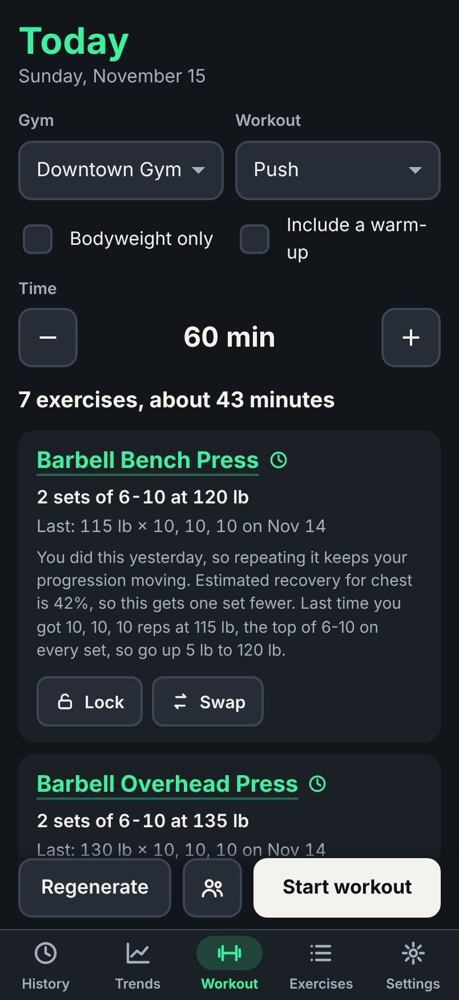
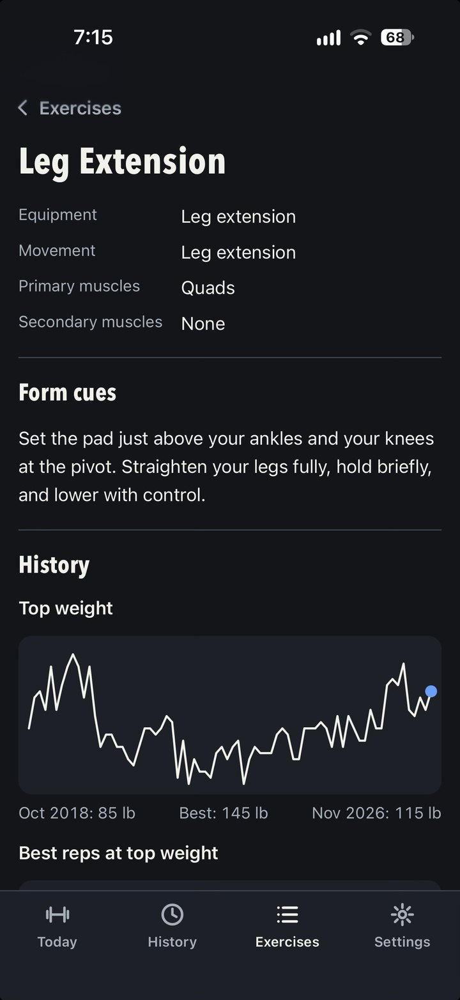

<p align="center">
  
</p>

ThoeneFit is a self-hosted workout planner and log built for phones. Pick a gym and it suggests a strength workout based on the equipment you have and what you lifted last time. Log sets at the gym, even without a signal, then review your progress in History and Trends.

**Use the app** · [Plan and log](#plan-and-log) · [Train together](#training-together) · [Strava](#send-a-workout-to-strava) · [Fitbod import](#import-from-fitbod) · [Accounts](#more-accounts-and-password-resets)

**Run your own copy** · [Local setup](#run-it-on-your-computer) · [DreamHost](#deploy-to-dreamhost) · [Backups](#backups-and-restore) · [Checks](#run-the-checks)

## Screenshots

| Workout planner | Set logging | Exercise history |
| :---: | :---: | :---: |
| <a href="docs/screenshots/workout-planner.jpg"></a> | <a href="docs/screenshots/set-logging.jpg"></a> | <a href="docs/screenshots/exercise-history.jpg"></a> |

## Plan and log

1. In **Settings → Gyms**, add a gym and select its equipment. You can set the smallest weight jump for each equipment type.
2. On **Today**, choose the gym and review the suggested workout. Change the workout type or time, lock a lift, swap it, or choose **Bodyweight only**.
3. Tap **Start workout** and log your sets in pounds or kilograms. Open **History** to review or edit past workouts, or **Trends** to see training activity and estimated recovery.

### How suggestions work

The planner uses your training split, goal, experience, and recent sets to pick exercises, sets, reps, and rest times. If every working set reaches the top of the rep range at the same weight, the next suggestion moves up by the gym's smallest increment. Machine and cable weights are tracked per gym. The recovery estimate uses logged sets, and a muscle below 50% gets one fewer set in a suggested workout.

### Saved routines

Tap **Save as routine** on Today or in a past workout in History. To start it again, pick it under **Today → Workout → Your routines**. The routine keeps the exercise order, set counts, and rep ranges while refreshing weight suggestions from your history. Rename or delete it under **Settings → Routines**.

### Cardio warm-ups

In **Settings → Gyms**, open your gym and select a machine under **Cardio**, then save. On **Today**, turn off **Bodyweight only** and tick **Include a warm-up** while viewing a suggested workout. The warm-up starts at 10 minutes the first time and uses your last logged time on later sessions. Log minutes and, optionally, distance and level. Cardio contributes to workout time while strength sets drive lifting volume, recovery, and weight suggestions.

### Estimated calories

Add your body weight in **Settings → Training**, then choose **Light**, **Moderate**, or **Hard** when finishing a workout. **History** shows an estimate based on your body weight, effort, and recorded workout time. A cardio warm-up is estimated separately from the lifting portion.

### Install and log offline

Open **Settings → Add to your Home Screen** for instructions for your browser. ThoeneFit also offers an install reminder on Today when you use it in a browser tab.

Once you've started a workout, you can log sets and use the rest timer offline. The status indicator shows when changes have synced. Generating a plan, swapping a lift, and opening History require a connection.

## Training together

On **Today**, tap the people button beside **Start workout**. During a session, tap **Share this workout**. The recipient accepts on their Today screen and gets the same exercise order, sets, reps, and rest times, with weights suggested from their own history. Each person logs a separate workout. A share expires after 24 hours if the recipient hasn't started it.

## Send a workout to Strava

Connect under **Settings → Account**. Select **Send to Strava** when finishing a workout, or open a completed workout in **History** to send it later.

- The basic export creates a Weight Training activity with its name, start time, and duration.
- **Include exercises, sets, reps, and weights** adds the workout log and muscle map. Cardio warm-ups and exercises without a Strava match go in the description.
- **Include estimated calories** sends the estimate in Strava's calorie field for a structured workout or in the description for a basic export.
- If the upload is still processing, tap **Check Strava upload**. When it's confirmed, tap **View on Strava**. Imported workouts without a recorded duration can't be exported.

### Set up Strava on DreamHost

Copy the `strava` block from [config.example.php](config.example.php) into the private `~/thoenefit-config.php`. Fill in the Client ID and Client Secret from [Strava API Settings](https://www.strava.com/settings/api). PHP needs OpenSSL and `allow_url_fopen`.

| Where | Production value |
| --- | --- |
| Strava **Authorization Callback Domain** | `fit.mikethoene.com` |
| DreamHost config `callback_url` | `https://fit.mikethoene.com/api.php?a=strava_callback` |

If Strava reports an invalid `redirect_uri`, compare those values and start again with **Connect to Strava**. If you rotate the Client Secret, disconnect and reconnect each linked account.

## Import from Fitbod

Open **Settings → Import from Fitbod**, choose the CSV and gym, then use **Check file** to review exercise matches. You can rename, edit, or skip unmatched exercises before importing.

Imports feed Trends and weight suggestions. Fitbod's **Cycling - Stationary** and **Stair Stepper** entries import as warm-ups. Other rows without reps, such as runs and timed holds, are skipped. Reimporting replaces earlier imports of the same data. Use **Remove imported workouts** to undo an import or **Export all sets as CSV** to download your ThoeneFit set history.

## More accounts and password resets

The first account is the admin. In **Settings → Manage users**, the admin can create accounts or set an invite token. With the token, someone can select **Request an account** on the sign-in screen, set a password, and sign in after approval.

To reset a password over SSH, run this command. It signs the account out on its devices.

```sh
php ~/fit.mikethoene.com/private/bin/create-user.php --reset USERNAME
```

### Sharing your own exercises with everyone

This command moves the named account's custom exercises into the default library. It preserves workout history and skips names that are already there.

```sh
php ~/fit.mikethoene.com/private/bin/promote-exercises.php mike
```

## Run it on your computer

From the repository root, use PHP 8.1+ with PDO SQLite and mbstring. The app creates `data/thoenefit.sqlite` by default.

```sh
php web/private/bin/create-user.php mike "Mike"
php -S localhost:8000 -t web
```

Open <http://localhost:8000>. For a phone on the same Wi-Fi, bind to `0.0.0.0:8000` and use the computer's LAN IP. Use HTTPS to test installation and offline mode from the phone.

## Deploy to DreamHost

1. Create a hosted site with HTTPS, a MySQL database, and a DreamHost shell user. PHP needs PDO MySQL and mbstring.
2. Copy [config.example.php](config.example.php) to `~/thoenefit-config.php` outside the web root. Fill in the database settings and run `chmod 600 ~/thoenefit-config.php`.
3. Set the GitHub Actions secrets `SFTP_HOST`, `SFTP_USER`, `SFTP_PASSWORD`, and `SFTP_PATH`. Use the production site's web folder for `SFTP_PATH`.
4. Push to `main` or run **Test and deploy** on `main` from GitHub Actions. Once the upload finishes, create the first account over SSH with `php ~/fit.mikethoene.com/private/bin/create-user.php mike "Mike"`. Use your own site's folder if it differs.

For this repository, `staging` deploys to `fit-test.mikethoene.com` and uses a separate `~/thoenefit-staging-config.php`. On another host, serve `web/` as the document root, keep the config above it, and deny HTTP access to `/private/`.

### Version number

Merging a release into `main` advances the patch version. Change [VERSION](VERSION) when starting a new minor or major version. When adding an app-shell file, update the `SHELL` list in [web/sw.js](web/sw.js). The deploy stamps the service worker's build ID automatically.

### What's new

Tap the version at the bottom of **Settings** to see **What's new**. The deploy generates release notes from PR titles. PRs from `feature/…` branches appear under **New** and PRs from `fix/…` branches appear under **Fixed**. Staging shows the next release's notes under **Coming next**.

### Updates and database changes

Migrations run on the first request after a deploy. To run them manually over SSH, use `php ~/fit.mikethoene.com/private/bin/migrate.php`.

## Backups and restore

Run these commands over SSH with the database details from the private config. Keep a copy of the backup off the server. Restoring replaces the tables in the dump.

```sh
# Back up
mkdir -p ~/backups
set -o pipefail
mysqldump --single-transaction --no-tablespaces -h DBHOST -u DBUSER -p DBNAME \
  | gzip > ~/backups/thoenefit-$(date +%F).sql.gz

# Restore a chosen backup
gunzip -c ~/backups/thoenefit-DATE.sql.gz | mysql -h DBHOST -u DBUSER -p DBNAME
```

For nightly backups, store the MySQL credentials in a `[client]` section of `~/.my.cnf` with permissions set to `600`. Omit `-p` from the cron command, escape the percent sign in `date +%F`, and prune old backups after a successful dump. For local SQLite, stop the app and copy `data/thoenefit.sqlite`.

## Run the checks

```sh
php tests/run.php
node tests/sync.test.mjs
node tests/search.test.mjs
node tests/install.test.mjs
node tests/version.test.mjs
node tests/changelog.test.mjs
```

GitHub Actions also runs the PHP checks on MySQL. See [tests/e2e.mjs](tests/e2e.mjs) for the local Playwright walkthrough.

## Project layout

| Path | What lives there |
| --- | --- |
| `web/js/` | App screens, exercise search, offline sync |
| `web/private/src/` | PHP API, workout generator, storage, Strava |
| `web/private/migrations/` | Database changes |
| `web/private/bin/` | Maintenance commands |
| `tests/` and `.github/workflows/` | Tests and deployment |
