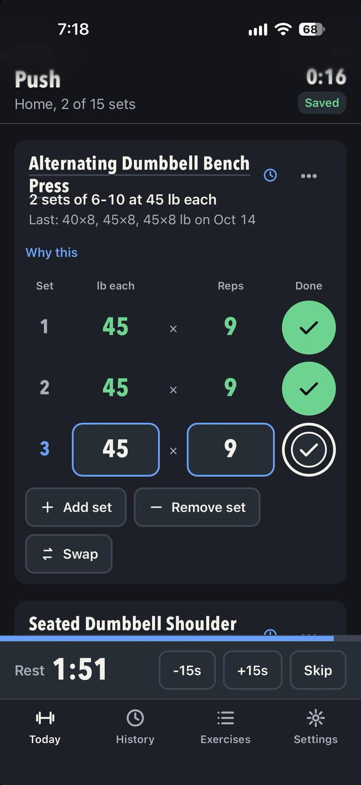

# ThoeneFit

Phone-first workout planner and log. Pick a gym and ThoeneFit builds a session around its equipment and your training history. Log sets between lifts, then look back at what you did and how your weights progressed.

**Use the app** · [Plan and log](#how-suggestions-work) · [Train together](#training-together) · [Send to Strava](#send-a-workout-to-strava) · [Import from Fitbod](#import-from-fitbod) · [Manage accounts](#more-accounts-and-password-resets)

**Maintain the app** · [Run locally](#run-it-on-your-computer) · [Run checks](#run-the-checks) · [Deploy](#deploy-to-dreamhost) · [Back up or restore](#backups-and-restore)

## Screenshots

| Workout planner | Set logging | Exercise history |
| :---: | :---: | :---: |
| <a href="docs/screenshots/workout-planner.jpg"></a> | <a href="docs/screenshots/set-logging.jpg"></a> | <a href="docs/screenshots/exercise-history.jpg"></a> |

## How suggestions work

1. Create a gym in **Settings**. Choose its equipment and the smallest weight jumps you can load. Each gym gets its own settings.
2. Open **Today**. ThoeneFit picks the next day in your full-body, upper/lower, or push/pull/legs split. You can change the day or time, lock a lift, or swap it.
3. Start the workout and log your sets in pounds or kilograms. Tap an exercise name on Today to see its trend, or open **History** to edit a completed session.

The planner favors familiar lifts that fit the gym’s equipment. It uses your goal, experience, and recent training to pick sets, reps, and rest. When all working sets reach the top of the rep range at the same weight, the next suggestion moves up by the gym’s smallest increment. Warm-ups don’t count toward progression. Machine and cable weights are tracked per gym.

The recovery estimate uses the sets you’ve logged. A muscle estimated below 50% gets one fewer set in a suggested workout. Sleep, soreness, and training outside the app aren’t part of that estimate.

### How offline logging works

After you start a workout, the rest timer and set logging work offline. Changes save on the phone and sync when you’re back online. The status pill shows whether the changes have reached the server. Generating a plan, swapping a lift, and opening History need a connection.

### Add it to your phone's Home Screen

- In **Safari on iPhone**, tap **Share → Add to Home Screen**.
- In **Chrome on Android**, open the menu and tap **Add to Home screen** or **Install app**.

## Training together

On **Today**, tap the people button next to **Start workout**. During a session, use **Share this workout**. The other person can accept or decline on their Today screen.

When they accept, they get the same exercise order, planned sets, reps, and rest as the sender has at that moment. Each person gets weight suggestions from their own history and logs a separate session. Later edits stay with the person who made them. Custom exercises are copied when needed. Shares expire after 24 hours if they go unanswered or the recipient doesn’t start the accepted workout.

## Send a workout to Strava

Connect under **Settings → Account**. Open a finished workout in **History** and tap **Send to Strava**.

- The basic export sends one Weight Training activity with its name, start time, and duration.
- Turn on **Include exercises, sets, reps, and weights** to populate the Strava workout log and muscle map. Exercises without a Strava match go in the description.
- For an upload that’s still processing, tap **Check Strava upload** or reopen the workout. Once it’s confirmed, **View on Strava** opens the activity. If the send is unconfirmed, check Strava before posting the workout yourself.
- Fitbod imports lack a recorded duration and can’t be exported.

### Set up Strava on DreamHost

Copy the `strava` block from `config.example.php` into the private `~/thoenefit-config.php` and fill in the Client ID and Client Secret from [Strava API Settings](https://www.strava.com/settings/api). PHP needs OpenSSL and `allow_url_fopen`.

If Strava reports an invalid `redirect_uri`, compare your settings with the production values below.

| Where | Production value |
| --- | --- |
| Strava **Authorization Callback Domain** | `fit.mikethoene.com` |
| DreamHost config `callback_url` | `https://fit.mikethoene.com/api.php?a=strava_callback` |

After changing the settings, start again with **Connect to Strava**. If you rotate the Client Secret, disconnect and reconnect each linked account.

## Import from Fitbod

Go to **Settings → Import from Fitbod**, choose the CSV, and pick a gym. Use **Check file** to review exercise matches before you import. Unmatched movements can be renamed, edited, or skipped.

Imported workouts feed trends and weight suggestions. Rows without reps, such as timed holds or cardio, are skipped. Reimporting the same data replaces earlier imports. Use **Remove imported workouts** to undo an import. To download your ThoeneFit set history, use **Export all sets as CSV** in Settings.

## More accounts and password resets

The first account is the admin. In **Settings → Manage users**, the admin can create accounts directly or set an invite token. A person with the token chooses **Request an account** on the sign-in screen and sets their own password. They can sign in after the admin approves the request.

Each account has its own gyms, history, and custom exercises. To reset a password over SSH, run the following command. Resetting signs out that user’s devices.

```sh
php ~/fit.mikethoene.com/private/bin/create-user.php --reset USERNAME
```

### Sharing your own exercises with everyone

The admin can move their custom exercises into the default library without breaking workout history. The command keeps the exercise IDs and skips names already in the library.

```sh
php ~/fit.mikethoene.com/private/bin/promote-exercises.php mike
```

## Run it on your computer

Use PHP 8.1 or newer with SQLite. Without a config file, the app creates its database at `data/thoenefit.sqlite`.

```sh
php web/private/bin/create-user.php mike "Mike"
php -S localhost:8000 -t web
```

Open <http://localhost:8000>. To test from a phone on the same Wi-Fi, bind to `0.0.0.0:8000` and open the computer’s LAN IP. Use HTTPS for installation and offline mode on the phone.

## Run the checks

```sh
php tests/run.php
node tests/sync.test.mjs
node tests/search.test.mjs
node tests/version.test.mjs
node tests/changelog.test.mjs
```

GitHub Actions also runs the PHP checks against MySQL. For the phone-sized Chrome walkthrough, see the Playwright instructions at the top of [tests/e2e.mjs](tests/e2e.mjs).

## Deploy to DreamHost

Pushing to `main` runs checks and uploads `web/` over SFTP. You can also run **Test and deploy** from GitHub Actions.

### One-time setup

1. Create a hosted site with HTTPS, a MySQL database, and a DreamHost shell user.
2. Fill in `config.example.php` with the database settings. Save it as `~/thoenefit-config.php` on DreamHost, outside the web root, and run `chmod 600 ~/thoenefit-config.php`.
3. Set GitHub Actions secrets `SFTP_HOST`, `SFTP_USER`, `SFTP_PASSWORD`, and `SFTP_PATH`. The path is the site’s web folder. The upload only runs if all four secrets are set.
4. Deploy, then create the first account over SSH with `php ~/fit.mikethoene.com/private/bin/create-user.php mike "Mike"`.

### Version number

The bottom of Settings shows the app version, such as `Version 0.1.104`. Each deploy to `main` raises the last number by one on its own; staging shows the number the next release will get, such as `0.1.105-staging`. To start a new minor or major version, change [`VERSION`](VERSION) (for example to `0.2.0`) and release it.

### What's new

Tapping the version opens **What's new**: each release and what it brought, newest first. Nobody writes these notes. Each deploy builds them from the titles of the pull requests a release brought in (see [`.github/scripts/changelog.mjs`](.github/scripts/changelog.mjs)), so:

- **Name branches by what they are.** `feature/...` is listed under **New**, `fix/...` under **Fixed**. Anything else, such as `chore/...`, is left out.
- **Title pull requests for the people using the app.** The title is the note, for example "Save and reuse workout templates".
- A release with no features or fixes doesn't appear. On staging, work that is merged but not yet released is listed at the top as **Coming next**.
- When the app reloads after a deploy, the "ThoeneFit was updated" message can be tapped to open the notes, but only if that release has any.

### Updates and database changes

Migrations run on the first request after a deploy. You can also run them over SSH.

```sh
php ~/fit.mikethoene.com/private/bin/migrate.php
```

If you change which files are cached for offline use, bump the version in `web/sw.js`.

## Backups and restore

Run these over SSH with the database details from the private config. Keep a copy of the backup off the server. Restoring a backup replaces the tables in the dump.

```sh
# Back up
mkdir -p ~/backups
set -o pipefail
mysqldump --single-transaction --no-tablespaces -h DBHOST -u DBUSER -p DBNAME \
  | gzip > ~/backups/thoenefit-$(date +%F).sql.gz

# Restore the database from a chosen backup
gunzip -c ~/backups/thoenefit-DATE.sql.gz | mysql -h DBHOST -u DBUSER -p DBNAME
```

For nightly backups, store the MySQL password in a `[client]` section of `~/.my.cnf` and set its permissions to `600`. Schedule the dump in cron without `-p`, escape the percent sign in `date +%F` in the cron entry, and prune old backups after a successful dump. For local SQLite, stop the app and copy `data/thoenefit.sqlite`.

## Project layout

| Path | What lives there |
| --- | --- |
| `web/js/` | App screens, exercise search, and the offline queue |
| `web/private/src/` | PHP API, workout generator, storage, and Strava integration |
| `web/private/migrations/` | Database changes |
| `web/private/bin/` | Maintenance commands |
| `tests/` and `.github/workflows/` | Tests and deployment |

On another host, use `web/` as the document root, keep the config above it, and block HTTP access to `/private/`.
