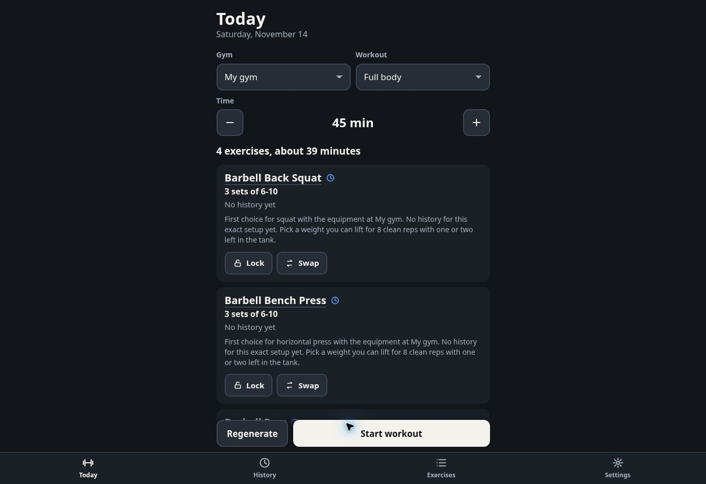
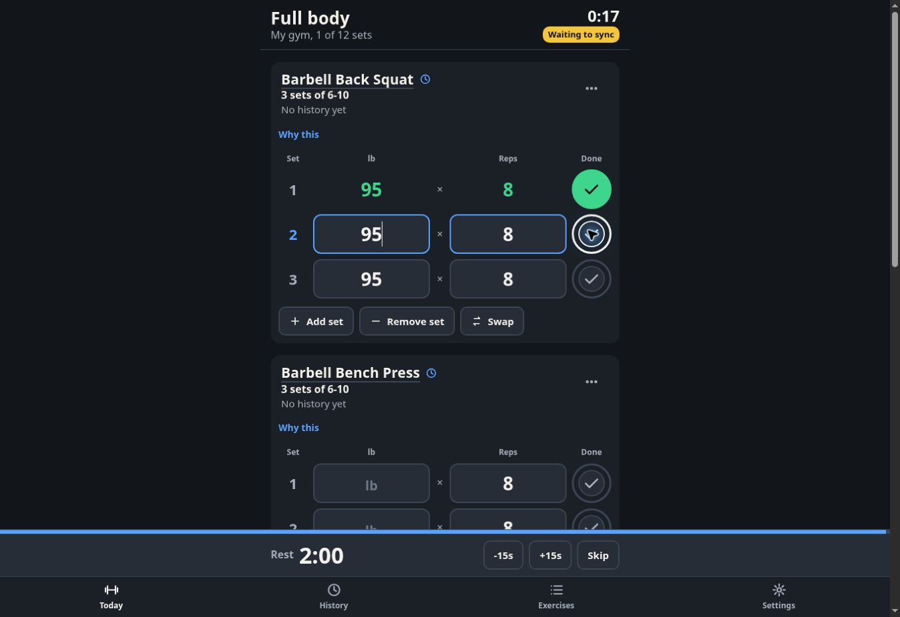
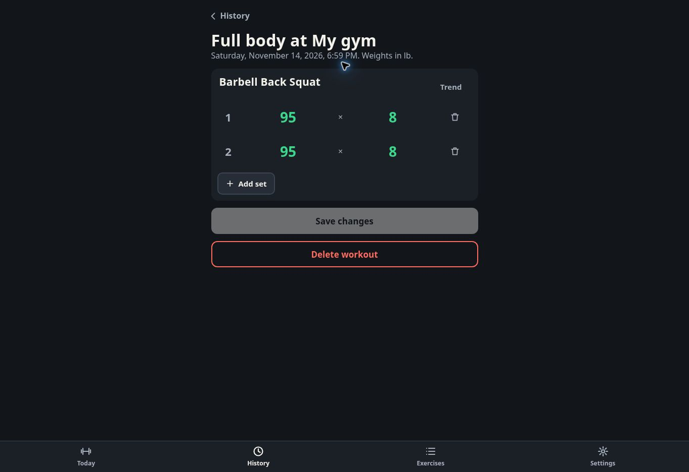

# ThoeneFit

A self-hosted workout planner and logger. Open it at the gym, get a session built from the equipment at that gym and what you have trained recently, and log sets between lifts. It runs on ordinary PHP hosting (built for DreamHost shared hosting) and installs to a phone's Home Screen.

- Gym profiles with their own equipment and weight increments
- Full body, upper/lower, and push/pull/legs splits; pounds or kilograms
- Rule-based workout generation with a reason for every pick and weight
- Fast set logging with a rest timer, autosave, and offline queueing
- Double progression, tracked per exercise and per equipment variant
- History you can edit, per-exercise trends, custom exercises, CSV export, Fitbod import
- Several accounts, no public sign-up; the first account is the admin and adds the others

## Screenshots

The planner, set logging, and saved workout screenshots use demo data.

| Workout planner | Set logging | Workout history |
| --- | --- | --- |
|  |  |  |

### Exercise history on mobile

The Leg Extension history screen shows how top weight has changed across logged workouts.


## Run it on your computer

You need PHP 8.0 or newer with the SQLite extension (included in most PHP installs). No database setup is needed locally: with no config file, the app keeps its data in `data/thoenefit.sqlite`.

```sh
# 1. Create an account (asks for a password of 10+ characters)
php web/private/bin/create-user.php mike "Mike"

# 2. Start the app
php -S localhost:8000 -t web
```

Open <http://localhost:8000> and sign in.

To try it from your phone on the same Wi-Fi, start it with `php -S 0.0.0.0:8000 -t web` and open `http://YOUR-COMPUTER-IP:8000`. Over plain HTTP the app works but cannot be installed or used offline; that needs the HTTPS deployment below.

## Run the checks

```sh
php tests/run.php            # server: generator, progression, sync, accounts, export
node tests/sync.test.mjs     # phone-side offline queue
node tests/search.test.mjs   # exercise search: spelling, typos, aliases, ranking
```

`tests/e2e.mjs` drives the whole app in Chrome at phone sizes. It needs Playwright and is optional; the instructions are at the top of that file.

Every push to `main` runs the first three on GitHub, including a run of the server checks against MySQL.

## Deploy to DreamHost

Code gets to the server through GitHub: every push to `main` runs the checks and then uploads the `web/` folder over SFTP. Docker and a reverse proxy are not involved, because shared hosting cannot run them and does not need them. DreamHost's own web server handles HTTPS.

### One-time setup

**1. Create the site.** In the DreamHost panel, add a domain or subdomain (for example `fit.example.com`) as a fully hosted site with PHP 8.1 or newer, and turn on the free Let's Encrypt certificate. Wait until `https://fit.example.com` loads without a certificate warning.

**2. Create a user with shell access.** The site needs a user of type **Shell** (not SFTP-only), because creating accounts and taking backups are done over SSH. Note:

- the server hostname (shown in the panel, for example `iad1-shared-b8-01.dreamhost.com`)
- the username and password
- the site's web folder, normally `/home/USERNAME/fit.example.com`

**3. Create a MySQL database.** In the panel's MySQL section, create a database, a hostname for it, and a database user. Note all four values.

**4. Put the config file on the server.** Copy `config.example.php`, fill in the four database values, and upload it to the folder above the web folder, named `thoenefit-config.php`:

```sh
scp thoenefit-config.php USERNAME@SERVER:~/thoenefit-config.php
ssh USERNAME@SERVER 'chmod 600 ~/thoenefit-config.php'
```

It lives outside the web folder, so it can never be downloaded, and it is not in this repository.

**5. Add the deploy secrets to GitHub.** In this repository: Settings, then Secrets and variables, then Actions, then New repository secret. Add four:

| Secret | Value |
| --- | --- |
| `SFTP_HOST` | the server hostname from step 2 |
| `SFTP_USER` | the username from step 2 |
| `SFTP_PASSWORD` | that user's password |
| `SFTP_PATH` | the web folder, for example `/home/USERNAME/fit.example.com` |

**6. Deploy.** Push to `main`, or open the Actions tab, pick "Test and deploy", and press "Run workflow". Until the secrets exist the upload step is skipped with a notice rather than failing.

**7. Create your account.** Over SSH:

```sh
ssh USERNAME@SERVER
php -v                                   # must say 8.0 or newer
php ~/fit.example.com/private/bin/create-user.php mike "Mike"
```

The first line of output names the database it is writing to. It should show your `thoenefit-config.php`. If `php -v` shows an older version, DreamHost keeps newer ones at paths like `/usr/local/php83/bin/php`; use that in place of `php`.

Open `https://fit.example.com`, sign in, and follow the setup screen.

### Add it to your phone's Home Screen

**iPhone:** open the site in Safari, tap the Share button, then Add to Home Screen, then Add.

**Pixel and other Android phones:** open the site in Chrome, tap the three-dot menu, then Add to Home screen (or Install app).

The same steps are in the app under Settings.

### More accounts and password resets

```sh
php ~/fit.example.com/private/bin/create-user.php sam "Sam"       # add a person
php ~/fit.example.com/private/bin/create-user.php --reset sam     # new password, signs out their devices
```

Each account has its own gyms, workouts, and custom exercises. People can change their own password in Settings.

**The admin.** The first account ever created is the admin. On a database that already had accounts when roles were added, the earliest-created account became the admin. The admin sees Settings, then Manage users, and can create accounts there with a starting password to pass on. Accounts made that way, or with `create-user.php` once an account exists, are regular users. There is still no public sign-up: every account-management request is checked on the server and refused unless it comes from the signed-in admin.

To see who the admin is, open Manage users, or run this over SSH with your database details:

```sh
mysql -h mysql.example.com -u DBUSER -p DBNAME -e "SELECT username, role, created_at FROM users ORDER BY created_at"
```

### Updates and database changes

Push to `main`. The upload replaces changed files and deletes nothing. Database changes are numbered files in `web/private/migrations/`; they apply themselves the first time the app is opened after a deploy. To apply them by hand: `php ~/fit.example.com/private/bin/migrate.php`.

After changing the list of files the app needs offline, bump `VERSION` in `web/sw.js` so phones fetch the new set.

## Import from Fitbod

In the app: Settings, then Import from Fitbod. Choose the CSV that Fitbod's "Export Workout Data" produces, pick the gym to file the workouts under, and press Check file. Nothing is saved until you press Import.

- Rows are grouped into workouts by their timestamp. Weights are converted from Fitbod's kilograms to your unit.
- Rows with no reps (cardio, planks and other timed holds) are left out.
- Fitbod exercises that are the same lift as a built-in exercise use it. The rest are added as your own exercises, with equipment, movement and muscles guessed from the name; edit them under Exercises. You can change or leave out any exercise on the check screen.
- Imported history feeds weight suggestions and trend charts like any other workout.
- Importing the same file again replaces the earlier import. "Remove imported workouts" on the same screen undoes it.

## Backups and restore

All data is in the MySQL database. Run these over SSH on the server, using the values from your config file.

**Back up:**

```sh
mkdir -p ~/backups
mysqldump --single-transaction --no-tablespaces -h mysql.example.com -u DBUSER -p DBNAME | gzip > ~/backups/thoenefit-$(date +%F).sql.gz
```

**Restore** (this replaces what is in the database with the backup):

```sh
gunzip < ~/backups/thoenefit-2026-11-14.sql.gz | mysql -h mysql.example.com -u DBUSER -p DBNAME
```

**Automatic nightly backups:** put the database password in `~/.my.cnf` so no prompt is needed,

```ini
[client]
password=YOUR-DATABASE-PASSWORD
```

run `chmod 600 ~/.my.cnf`, then add a cron job in the DreamHost panel (or with `crontab -e`) that runs daily and keeps 30 days:

```sh
mysqldump --single-transaction --no-tablespaces -h mysql.example.com -u DBUSER DBNAME | gzip > ~/backups/thoenefit-$(date +\%F).sql.gz && find ~/backups -name 'thoenefit-*.sql.gz' -mtime +30 -delete
```

Download a copy now and then (`scp USERNAME@SERVER:~/backups/thoenefit-DATE.sql.gz .`) so a backup exists somewhere other than the server. Each person can also export their own sets as CSV from Settings.

On a local copy, the backup is the single file `data/thoenefit.sqlite`: stop the app and copy it.

## How suggestions work

Nothing is random or learned. The same profile, gym, and history always give the same workout.

- **Which day.** The next day in your split after your last finished workout. You can pick another on the Today screen.
- **Which exercises.** Each day has an ordered list of movement slots (for Push: a horizontal press, an overhead press, an incline press or fly, triceps, then optional extras). A slot is filled only by exercises whose equipment is all ticked in the selected gym. Among those, it prefers the exercise you have done recently so progression continues, then the catalog's first choice. Optional slots go to muscles with the fewest sets in the last 7 days.
- **How many.** Slots are added until the estimated time (sets, rest, and setup) reaches the time you set, with a minimum of three.
- **Sets, reps, rest.** From your goal and experience. Big lifts get lower reps and longer rests than accessories.
- **Weight.** Double progression: if every working set last time was at the working weight and reached the top of the rep range, the suggestion goes up by the gym's smallest increment for that equipment and reps restart at the bottom of the range. Otherwise the weight stays and the aim is more reps. Warm-up sets are ignored. You can type over any suggestion.
- **Equipment variants.** Barbell, dumbbell, kettlebell, and bodyweight history follows you between gyms. Machine and cable history is kept separately per gym, because the same number means different things on different machines.
- **Recovery.** An estimate from logged sets only: after a session, a muscle is treated as needing 24 hours plus 6 hours per set (half for secondary muscles), up to 96 hours. Under 50%, an exercise for that muscle gets one set fewer. It cannot see sleep, soreness, or anything done outside the app.

## How offline logging works

The phone is the source of truth during a workout. Every edit is written to the phone's storage first, then the whole workout is sent to the server with a rising revision number. The server replaces its copy of that workout, so a save that is retried after a dropped connection, or delivered twice, cannot create duplicate sets. The pill at the top of the workout screen shows Saved, Saving, or that changes are waiting on the phone. Building a new workout, swapping exercises, and History need a connection.

## Project layout

```
web/                    the folder the web server serves (uploaded on deploy)
  index.html app.css    app shell
  js/app.js             screens
  js/store.js           server calls and the offline workout queue
  js/search.js          exercise search (typos, aliases, similar exercises)
  js/ui.js              small interface helpers
  sw.js                 keeps the app's files on the phone for offline use
  api.php               entry point for all server calls
  private/              never served (blocked by .htaccess)
    src/                PHP: accounts, catalog, generator, workout storage, API
    migrations/         numbered database changes
    bin/                create-user.php, migrate.php
config.example.php      template for the server's config file
tests/                  checks
.github/workflows/      test and deploy on push
```

## Moving off shared hosting later

Nothing here depends on DreamHost. Any server with PHP 8.0+, MySQL or MariaDB, and HTTPS will run it: point the web root at `web/`, put `thoenefit-config.php` one level above it (or set the `THOENEFIT_CONFIG` environment variable to its path), and make sure requests to `/private/` are refused if the server is not Apache.
